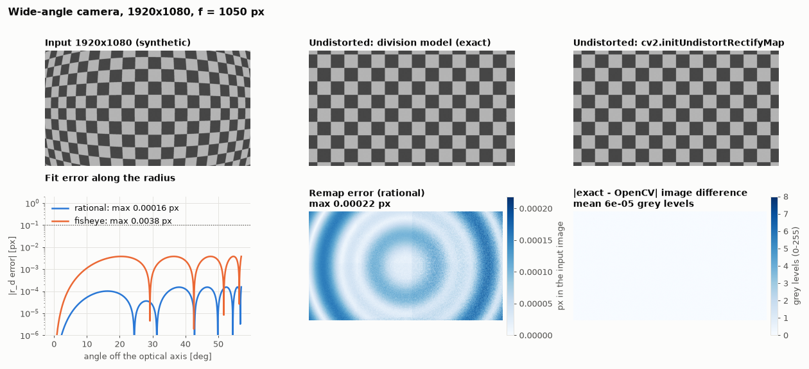
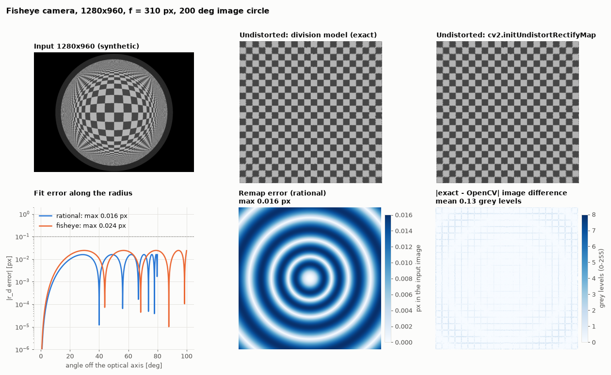

# division-to-opencv

Fit OpenCV distortion coefficients (rational or fisheye) that reproduce a division-model
undistortion, with sub-pixel accuracy and no calibration images.

Your camera is calibrated with the **division model**, so undistortion is a closed form
and fast, but OpenCV, ROS `CameraInfo`, Foxglove and most other tools only understand
OpenCV's own models. This tool converts the division model into

* the **rational** model (`cv2.initUndistortRectifyMap`, ROS `rational_polynomial`), or
* the **fisheye** model (`cv2.fisheye`, Kannala-Brandt, ROS `equidistant`),

and tells you how accurate the conversion is.



## Install

```bash
pip install git+https://github.com/zatakon/division-to-opencv
```

Requires Python 3.10+, `numpy` and `opencv-python-headless`.

## Usage

### Command line

```bash
division-to-opencv --coeffs -2.1e-7 -4e-14 --focal 1050 --center 963.4 538.2 --size 1920 1080
```

```text
division model c = [-2.1e-07, -4e-14], f = 1050 px, fitted up to r_d = 1105.5 px
K = [[1050.0, 0.0, 963.4], [0.0, 1050.0, 538.2], [0.0, 0.0, 1.0]]

[rational]
  D = [0.994553258, 0.289269815, 0.0, 0.0, 0.00935983015, 1.22606426, 0.514714888, 0.0504306632]
  fitted r_d <= 1105.5 px (57.0 deg off-axis)
  error: max 0.0002 px, rms 0.0001 px

[fisheye]
  D = [0.102059836, -0.0413847605, -0.00913833803, 0.00689881325]
  fitted r_d <= 1105.5 px (57.0 deg off-axis)
  error: max 0.0038 px, rms 0.0025 px
```

Options:

| Option | Meaning |
|---|---|
| `--coeffs C1 C2 ...` | division model coefficients, pixel units (see [Model](#model)) |
| `--focal F` | focal length in pixels (`fx = fy`) |
| `--center CX CY` | centre of distortion, OpenCV pixel convention |
| `--size W H` | image size; the fit covers the farthest image corner |
| `--max-radius R` | fit up to this distorted radius instead of `--size` |
| `--model rational\|fisheye\|both` | which model(s) to fit (default both) |
| `--max-angle DEG` | rational: largest off-axis angle to fit (default 80) |
| `--fisheye-max-angle DEG` | fisheye: limit the fit, e.g. to the image circle |
| `--json` | machine-readable output |

### Python

```python
import cv2
from division_to_opencv import (DivisionModel, camera_matrix, fit_rational, max_radius,
                                undistortion_maps)

model = DivisionModel([-2.1e-7, -4.0e-14])
center, f, size = (963.4, 538.2), 1050.0, (1920, 1080)

fit = fit_rational(model, f, max_radius(size, center))
print(fit.D, fit.max_error_px)

K = camera_matrix(f, center)
newK = camera_matrix(f / 2, (479.5, 269.5))          # half-resolution output
map_x, map_y = undistortion_maps(fit, K, newK, (960, 540))
undistorted = cv2.remap(image, map_x, map_y, cv2.INTER_LINEAR)
```

`reference_maps(model, K, newK, size, r_max)` returns the exact division-model maps for the
same geometry, and `map_error(...)` compares the two, so you can check the result on your
own output resolution.

## Model

The division model maps a distorted radius `r_d` (pixels from the centre of distortion) to
the undistorted radius

```text
r_u = r_d / P(r_d),     P(r) = 1 + c1 r^2 + c2 r^4 + ... + cn r^(2n)
```

The ray seen at `r_d` points `theta = atan2(r_d, f P(r_d))` off the optical axis.
`P(r_d) = 0` is 90 degrees; beyond it (`P < 0`) a fisheye lens still sees the ray, but no
pinhole image can show it.

If your implementation uses other conventions, convert first:

* **normalised radius**: with `P = 1 + a1 (r/f)^2 + a2 (r/f)^4 + ...` use `c_i = a_i / f^(2i)`
* **pixel origin at the corner** of the first pixel: subtract 0.5 from the centre
* **other encodings** of the coefficients: convert them to plain `c_i`

## How it works

Both models are radial around the same centre, so the whole conversion is a **1-D curve
fit**. No calibration images or detected corners are needed.

* **rational**: `r_d = r_u (1 + k1 x + k2 x^2 + k3 x^3) / (1 + k4 x + k5 x^2 + k6 x^3)`,
  `x = (r_u / f)^2`, `p1 = p2 = 0`. Two linear least-squares solutions give the starting
  points: the full model with the denominator multiplied out, and the polynomial alone
  (denominator 1). Levenberg-Marquardt then minimises the error in pixels and only accepts
  steps that keep the denominator positive, so the result never has a pole inside the
  fitted range.
* **fisheye**: `r_d = f theta (1 + k1 theta^2 + ... + k4 theta^8)` is linear in `k` and
  already in pixels.

Both fits finish with Lawson's iteratively reweighted least squares, which minimises the
**maximum** error rather than the rms, because the maximum is the accuracy that is reported.
The samples are spread uniformly over the distorted radius up to the farthest image corner,
so the whole image is covered with the same weight. A conversion takes well under a second.

## Accuracy

Results of `python examples/demo.py` on two made-up cameras:

| Camera | Model | Fitted range | Max error |
|---|---|---|---|
| wide-angle, 1920x1080, f = 1050 | rational | whole image (57 deg) | 0.0002 px |
| | fisheye | whole image (57 deg) | 0.004 px |
| fisheye, 1280x960, f = 310 | rational | up to 80 deg | 0.016 px |
| | fisheye | image circle (100 deg) | 0.024 px |



Errors are in pixels of the distorted image. The accuracy depends on the lens: always look
at `max_error_px` for your camera.

## Limits and pitfalls

* **Only use the fitted range.** A rational polynomial extrapolates badly; outside
  `fitted_radius_px` it can be off by thousands of pixels. Fit up to the image corners
  (`--size`), not just to the image border.
* **The rational model is pinhole based** and cannot go to 90 degrees; it gets inaccurate
  beyond about 80 degrees. Use the fisheye model for wider lenses.
* **High-order calibrations may not convert exactly.** A division model with many
  coefficients whose terms are large and of alternating sign (typical of an over-fitted
  calibration) has a wavy curve that 6 rational or 4 fisheye coefficients cannot follow
  exactly; expect tenths of a pixel or more. Check `max_error_px` and, if it is too high,
  lower `--max-angle` to the part of the image you need. Such a polynomial may also reach
  `P = 0` (90 degrees) inside the image corners although the lens cannot see that far.
* **The fisheye fit includes rays beyond 90 degrees** when the model reaches them within
  the fitted radius (the result then carries a note). If your lens cannot see them, limit
  the fit with `--fisheye-max-angle`.
* **`cv2.fisheye.projectPoints` cannot project rays beyond 90 degrees** (it divides by
  `z`). The fitted coefficients still describe them; use
  `division_to_opencv.project_fisheye` to project such points.
* **Already undistorted images** need no fit: they are pinhole images with the
  `newK` you undistorted to and `D = 0`.
* Square pixels (`fx = fy`) and no skew are assumed.

## Development

```bash
pip install -e ".[dev,examples]"
pytest
python examples/demo.py   # regenerates docs/*.png
```

## License

MIT
